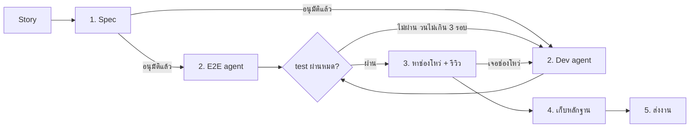

# Story Flow

> **Last updated:** 2026-11-06 Asia/Bangkok (UTC+07:00)

จาก story หรือ task (feature/fix) จนเปิด PR โดย session หลักคุมงานและแบ่งงานให้ subagent ผ่าน skill `/story`

- story หรือ task list: รัน `/to-spec` (และ `/to-tickets` ถ้างานใหญ่) เองก่อน แล้วสั่ง `/story #<issue>`
- งานแก้เล็กๆ: สั่ง `/story <สิ่งที่จะแก้>` ได้เลย

## Skill หลัก

| ขั้น | ใครทำ | Skill |
| --- | --- | --- |
| 1. Spec | คุณ | `to-spec` |
| 1. เติม spec และจัดกลุ่ม PR | Session หลัก | `story` |
| 2. เขียน e2e | E2E agent | `playwright-cli` |
| 2. พัฒนา | Dev agent | `tdd` |
| 3. หาช่องโหว่ | Security agent | `security-review` |
| 3. รีวิวโค้ด | Session หลัก | `code-review` |
| 4. เก็บหลักฐาน | Evidence agent | `playwright-cli` |
| 5. ส่งงาน | Session หลัก | `verification-before-completion` → `commit` → `pull-request` |

`security-review` และ `code-review` มีเฉพาะใน Claude Code ส่วนใน Codex ให้ใช้ `best-practices` แทน

## ขั้นตอน

### 1. Spec

คุณรันเอง (`/story` เรียกแทนไม่ได้ เพราะ skill เหล่านี้ตั้ง `disable-model-invocation: true`):

1. ครั้งแรกของแต่ละ repo: รัน `/setup-matt-pocock-skills` แล้วเลือก issue tracker เป็น GitHub หรือ GitLab issue
2. story ยังไม่ชัด: ใช้ `/grill-me`
3. รัน `/to-spec` แล้วยืนยัน seam
4. story ใหญ่หรือ task list: รัน `/to-tickets`

`/story` ทำต่อ:

5. เติมใน spec 3 ส่วน:
   - acceptance criteria แบบ Given/When/Then
   - ชื่อปุ่มหรือช่องกรอกที่ e2e จะใช้กับ `getByRole` / `getByLabel`
   - จุดที่อาจถูกโจมตี
6. มี ticket: จัดกลุ่ม ticket ที่แก้ส่วนเดียวกันเป็น 1 PR แล้ววนตั้งแต่ "พัฒนาและเขียน e2e" ถึง "ส่งงาน" ทีละกลุ่ม
7. สร้าง branch ที่มีเลข issue เช่น `feat/123-<slug>` เพื่อให้ PR ปิด issue ได้ด้วย `Closes #123`

### 2. พัฒนาและเขียน e2e (ทำพร้อมกัน)

- **E2E agent**: ใช้ `playwright-cli` เขียน e2e จาก spec อย่างเดียว แก้ได้เฉพาะไฟล์ใน `e2e/`
- **Dev agent**: ใช้ `tdd` เขียน unit และ integration test ที่ seam ที่ยืนยันแล้ว จนทุก test ผ่าน ห้ามแก้ไฟล์ e2e
- **Session หลัก**: รัน test ทั้งหมด
  - ตัวที่พังส่งกลับไปให้ Dev แก้
  - ถ้าถกกันว่า test ผิดหรือโค้ดผิด ให้ตัดสินจาก spec
  - วนได้ไม่เกิน 3 รอบ เกินนั้นถามคุณ
- **ใช้เพิ่มตามงาน**:
  - `codebase-design`: วาง seam
  - `debug-mantra`: test พังแต่ยังหาสาเหตุไม่เจอ
  - `find-docs`: API ของ library
  - `typescript-magician`: type ซับซ้อน
  - `vercel-react-best-practices`, `vercel-composition-patterns`: React/Next.js
  - `supabase-postgres-best-practices`: Postgres
  - `modern-web-guidance`: HTML/CSS/JS
  - `impeccable`: UI/UX และ accessibility
  - `design-taste-frontend`: หน้าเว็บ public

### 3. หาช่องโหว่และรีวิว

- **Security agent**: เป็นตัวใหม่ที่ไม่ได้เห็นงานรอบก่อน ใช้ `security-review` อ่าน diff แล้วเขียน test ที่พิสูจน์ช่องโหว่ จากนั้นส่งให้ Dev แก้
- **Session หลัก**: ใช้ `code-review` รีวิวโค้ดและ refactor
- **ใช้เพิ่มตามงาน**:
  - `best-practices`: ตรวจ security และ compatibility เพิ่ม
  - `performance`: spec มีเป้าหมายด้านความเร็ว
  - `seo`: หน้า public ที่ต้องติด search

### 4. เก็บหลักฐาน

**Evidence agent**: ใช้ `playwright-cli` ถ่าย screenshot ของแต่ละ acceptance criteria แล้วทำตาราง criteria → test → ผลลัพธ์ → รูป

### 5. ส่งงาน

1. `verification-before-completion`: รัน test ทั้งหมดจริงก่อนบอกว่าเสร็จ
2. `commit`
3. `pull-request`: แนบ screenshot ด้วย `--attach` และอ้างรูปใน body ด้วย ``

## กติกา

- session หลักเป็นตัวคุมงาน เพราะ subagent สร้าง subagent ต่อไม่ได้ และถามคุณไม่ได้
- ยืนยัน seam กับคุณในขั้น 1 แล้วส่งให้ Dev agent ในสถานะ "ยืนยันแล้ว"
- แต่ละ agent แก้เฉพาะไฟล์ของตัวเอง และห้ามลบ ข้าม หรือลดความเข้มของ test เพื่อให้ผ่าน
- แบ่งชนิด test:
  - integration test อยู่กับ Dev
  - test security ระดับ API (สิทธิ์เข้าถึงข้อมูลคนอื่น, validate input) เขียนเป็น integration test
  - e2e ใช้เฉพาะ user journey สำคัญ และช่องโหว่ฝั่งหน้าบ้าน
- screenshot ไม่ต้อง commit ให้เก็บใน `.story/<issue>-<slug>/` ที่เพิ่มไว้ใน `.git/info/exclude`
- งานเล็ก: ไม่ต้องแยก agent ในขั้น 2 ให้ session หลักใช้ `tdd` เองแล้วไปขั้น 3
