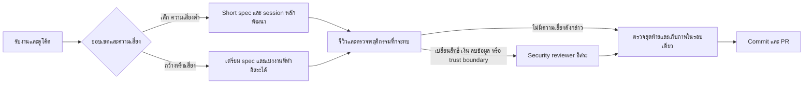

# Story Flow

> **Last updated:** 2026-11-17 Asia/Bangkok (UTC+07:00)

จากไอเดีย, story หรือ task (feature/fix) จนเปิด PR ผ่าน `/story` โดยเลือกขั้นตอนตามขอบเขตและความเสี่ยงก่อนวางแผน งานเล็กทำใน session หลัก งานที่แบ่งทำอิสระได้จึงใช้ subagent

- ไอเดียหรือ task list: สั่ง `/story <สิ่งที่ต้องการ>` แล้วให้ session หลักเรียกขั้นวางแผนที่ยังขาด
- มี spec แล้ว: สั่ง `/story #<issue>` หรือ `/story <path ของ spec>` เพื่อใช้ของเดิม
- feature หรืองานแก้เล็กๆ: สั่ง `/story <สิ่งที่ต้องการ>` ได้เลย เช่นเพิ่ม dialog แสดงข้อมูลที่ใช้ component เดิม
- งานค้าง: สั่ง `/story #<issue เดิม>` หรืออ้างงานเดิม เพื่อทำต่อจากขั้นที่ยังไม่เสร็จ รวมถึงขั้นวางแผน
- ให้ agent CLI ช่วยทำ: เติม `cli` ท้ายคำสั่ง เช่น `/story #<issue> cli` (ดูหัวข้อ "ส่งบทให้ agent CLI")

## Skill หลัก

| ขั้น | ใครทำ | Skill |
| --- | --- | --- |
| 1. ตั้งค่าและทำ requirement ให้ชัดเมื่อจำเป็น | Session หลัก + คุณตัดสินใจ | `setup-matt-pocock-skills`, `grill-me` |
| 1. Spec และ tickets เมื่อจำเป็น | Session หลัก + คุณยืนยัน | `to-spec`, `to-tickets` |
| 1. เติม spec และจัดกลุ่ม PR | Session หลัก | `story` |
| 2. เขียน e2e เมื่อจำเป็น | Session หลัก หรือ E2E agent เมื่อมีงานอิสระมากพอ | `playwright-cli` |
| 2. พัฒนา | Session หลัก หรือ Dev agent | `tdd` สำหรับพฤติกรรมที่ไม่ trivial |
| 3. หาช่องโหว่ | Session หลักตรวจทุกงาน; Security agent อิสระเมื่องานเสี่ยงหรือถูกกำหนดไว้ | `security-review` |
| 3. รีวิวโค้ด | Session หลัก | `code-review` |
| 4. เก็บหลักฐาน | ผู้ตรวจ UI ในรอบเดียวกัน; Evidence agent เฉพาะภาพที่ขาดและมีงานมากพอ | `playwright-cli` |
| 5. ส่งงาน | Session หลัก | `verification-before-completion` → `commit` → `pull-request` |

`security-review` และ `code-review` มีเฉพาะใน Claude Code ส่วนใน Codex ให้ใช้ `best-practices` แทน

## ขั้นตอน

### 0. เลือกเส้นทางก่อนวางแผน

| เส้นทาง | เกณฑ์ | วิธีทำ |
| --- | --- | --- |
| เล็กและความเสี่ยงต่ำ | พฤติกรรมเฉพาะจุด ใช้ component/contract เดิม ไม่เปลี่ยนสิทธิ์ การแยก tenant การลบข้อมูล เงิน schema/migration หรือ trust boundary | Short spec → session หลักพัฒนาและรีวิว → test ที่เกี่ยวข้องและตรวจ UI → ส่งงาน |
| ปกติ | ผลกระทบกว้าง ยังไม่แน่ใจขอบเขต หรือมีความเสี่ยงข้างต้น | เตรียม spec เท่าที่ขาด เลือก test ตามผลกระทบ แบ่ง agent เฉพาะงานอิสระที่คุ้มกับการส่งต่อ |
| หลายกลุ่ม | มีหลาย deliverable ที่แยกส่งได้ | เลือกเส้นทางต่อกลุ่ม แล้วทำตามลำดับ dependency |

มี issue หรือ spec ยาวไม่ได้แปลว่างานใหญ่ และ feature ใหม่ก็เป็นงานเล็กได้ แต่ dialog ลบข้อมูลหรือเปลี่ยนสิทธิ์ไม่เข้าเส้นทางความเสี่ยงต่ำ ถ้าระหว่างทำพบผลกระทบเพิ่มให้ปรับเส้นทาง พร้อมบันทึกเหตุผลใน `progress.md`

### 1. Spec

`/story` ตรวจแล้วเรียก skill ที่จำเป็นเองใน session หลัก คุณยังเรียกแต่ละ skill แยกได้:

1. ต้องใช้ tracker แต่ยังไม่ได้ตั้งค่า: เรียก `setup-matt-pocock-skills` แล้วเลือก GitHub, GitLab หรือไฟล์ local โดยใช้การตัดสินใจเดิมได้
2. requirement ยังมีประเด็นสำคัญไม่ชัด: เรียก `grill-me` พร้อมข้อมูลที่ทราบแล้ว ให้คุณตอบเฉพาะเรื่องที่ยังไม่ได้ตัดสินใจ
3. ยังไม่มี spec ที่ใช้ได้: เรียก `to-spec` ให้ยืนยัน spec และ seam ก่อนเผยแพร่ ถ้ามี spec แล้วให้อ่านและเติมเฉพาะส่วนที่ขาด
4. งานครอบคลุมหลายส่วนและยังไม่มี tickets: เรียก `to-tickets` ให้คุณยืนยันการแบ่งงานก่อนสร้าง

feature หรืองานแก้เล็กที่ความเสี่ยงต่ำใช้ short spec และยืนยันใน session นี้ได้เลย โดยไม่บังคับตั้ง tracker, สัมภาษณ์หรือสร้าง tickets การเรียก skill เองไม่ได้แทนการอนุมัติของคุณ แต่เรื่องที่ยืนยันแล้วและยังเหมือนเดิมไม่ต้องถามซ้ำ

`/story` ทำต่อ:

5. เติมใน spec 3 ส่วน:
   - acceptance criteria แบบ Given/When/Then
   - ชื่อปุ่มหรือช่องกรอกที่ e2e จะใช้กับ `getByRole` / `getByLabel`
   - จุดที่อาจถูกโจมตี
6. มี ticket: จัดกลุ่ม ticket ที่แก้ส่วนเดียวกันเป็น 1 PR ให้ยืนยันส่วนเพิ่มเติมและกลุ่มที่ยังไม่เคยอนุมัติ แล้ววนตั้งแต่ "พัฒนาและเขียน e2e" ถึง "ส่งงาน" ทีละกลุ่ม
7. สร้าง branch ที่มีเลข issue จริง เช่น `feat/123-<slug>` เพื่อให้ PR ปิด issue ได้ด้วย `Closes #123` ถ้าเป็นงาน local ที่ไม่มี issue ใช้ `feat/<slug>` หรือ `fix/<slug>` โดยไม่ใส่ `Closes`

บันทึก `progress.md` ตั้งแต่ก่อนเริ่มวางแผนใน `.story/<slug>/` ใช้ชื่อสั้นก่อนเมื่อยังไม่มี issue แล้วคงโฟลเดอร์เดิมไว้ เก็บ draft, สิ่งที่อนุมัติและ revision, คำถามที่ค้าง, เลข issue/ticket และขั้นถัดไป ก่อนสร้างแต่ละ issue ให้บันทึกสถานะรอผลและบันทึก ID ทันทีที่สำเร็จ หากถูกตัดกลางทางให้ตรวจ tracker ก่อนลองใหม่เพื่อไม่สร้างซ้ำ ถ้า requirement เปลี่ยน ให้ยืนยันส่วนที่เปลี่ยนและทำขั้นที่ได้รับผลกระทบใหม่

สี่ skill วางแผนต้องเปิด model invocation ทั้งใน `SKILL.md` และ policy ของ Codex; ดูการตั้งค่า local ใน `SYNC.md` หากขาด skill หรือยังถูกปิดไว้ `story` จะรายงานจุดที่ติด

### 2. พัฒนาและเลือกการตรวจตามผลกระทบ

- **วางแผนก่อนตรวจ**: บันทึกคำสั่ง ขอบเขต เหตุผล และเจ้าของ ไม่บังคับเขียน unit + integration + e2e ซ้ำพฤติกรรมเดียวกัน คำสั่งที่ repo/ผู้ใช้กำหนดยังต้องทำครบ
- **งานเล็ก**: session หลักพัฒนาและตรวจเอง ใช้ TDD สำหรับ logic/bug fix ที่ไม่ trivial งานแก้ copy/style ใช้ check เดิมและดูผลจริงตามความเหมาะสม
- **งานที่ควรแบ่ง**: Dev ทำ implementation; เพิ่ม E2E agent เฉพาะมีงาน browser test อิสระมากพอ แก้ได้เฉพาะ directory จาก `playwright.config.*` ส่วน Dev ไม่แก้ไฟล์ของ E2E
- **ทำพร้อมกันได้เฉพาะการอ่าน/เขียนไฟล์ที่ไม่ทับกัน**: Dev รัน scoped test ระหว่างพัฒนา ส่วน E2E เขียนจาก spec แล้วส่งคำสั่งที่ยังไม่ได้รันกลับมา รอ Dev เสร็จแล้ว session หลักจึงรัน browser/integration checks ที่ค้าง
- **Session หลัก**: อ่านผลจริงและ diff ของ Dev ไม่รัน test ที่ผ่านแล้วซ้ำทันทีเพียงเพราะส่งต่องาน และรับผิดชอบการตรวจสุดท้าย
  - ตัวที่พังส่งกลับไปให้ผู้พัฒนาแก้ พร้อมสาเหตุและ output
  - ถ้าถกกันว่า test ผิดหรือโค้ดผิด ให้ตัดสินจาก spec
  - แยก bug ออกจาก server/fixture/resource failure แก้สาเหตุก่อนรันใหม่ ไม่วนจนบังเอิญผ่านหรือเพิ่ม timeout เพื่อให้เขียว; วนแก้ไม่เกิน 3 รอบ เกินนั้นถามคุณ
- **ใช้เพิ่มตามงาน**:
  - `codebase-design`: วาง seam
  - `debug-mantra`: test พังแต่ยังหาสาเหตุไม่เจอ
  - `find-docs`: API ของ library
  - `typescript-magician`: type ซับซ้อน
  - `vercel-react-best-practices`, `vercel-composition-patterns`: React/Next.js
  - `supabase-postgres-best-practices`: Postgres
  - `modern-web-guidance`: HTML/CSS/JS
  - `impeccable`: UI/UX และ accessibility
  - `design-taste-frontend`: หน้าเว็บ public

### 3. หาช่องโหว่และรีวิว

- **Security agent อิสระ**: ต้องมีเมื่อเปลี่ยน authorization/tenant isolation, destructive action, logic การเงิน, schema/migration หรือ trust boundary เช่น upload/untrusted rendering รวมถึงเมื่อ repo/ผู้ใช้กำหนด อ่าน diff และเส้นทางที่กระทบ แล้วเขียน test พิสูจน์ปัญหาในขอบเขต
- **Session หลัก**: งานอื่นตรวจ security รวมใน code review แก้ข้อบกพร่องของงานและผลกระทบโดยตรง ไม่ขยายเป็น whole-site audit หรือ refactor ทั่ว repo
- **ปัญหาเดิมที่ไม่เกี่ยวกับงาน**: รายงานสั้นๆ แยกไว้ ไม่เขียน reproducer หรือแก้ต่อใน story นี้ แต่ถ้าทำให้งานนี้ไม่ปลอดภัยต้องแจ้งเป็น blocker
- **ใช้เพิ่มตามงาน**:
  - `best-practices`: ตรวจ security และ compatibility เพิ่ม
  - `performance`: spec มีเป้าหมายด้านความเร็ว
  - `seo`: หน้า public ที่ต้องติด search

### 4. เก็บหลักฐาน

screenshot มีไว้ 3 อย่าง: ให้ผู้ใช้เห็นผลงานที่เสร็จ ให้ภาพชี้ชัดว่าเปลี่ยนอะไรตรงไหน และเมื่อผู้ใช้ confirm แล้วใช้แนบ PR ให้ผู้ตรวจเห็นว่า PR ทำอะไร งานที่เปลี่ยน UI ต้องมีทุกครั้งไม่ว่าเส้นทางไหน

เก็บ screenshot จาก passing test หรือ browser session ที่ใช้ตรวจ UI อยู่แล้ว ทุกภาพต้องวงแดงพร้อมป้ายเลขและคำอธิบายรอบ element ที่พิสูจน์ และมีแถบสีแดงขอบล่าง `<AC id> — <criterion>` ใช้ helper วงรูปของ repo ถ้ามี (เพิ่มแถบ caption ถ้ายังไม่มี) ไม่มีให้วาด overlay ด้วย `playwright-cli` `eval` ภาพเดียวอ้างหลาย criteria ได้เมื่อพิสูจน์ได้จริง

AC ที่ภาพพิสูจน์ไม่ได้ (API, สิทธิ์, ข้อมูลใน DB, migration, งานเบื้องหลัง, ค่าที่เก็บใน browser) ใช้เทสต์ที่ผ่านคู่กับตัวอย่างผลลัพธ์จริงแบบข้อความจากข้อมูลทดสอบ เช่น request/response ที่ตัดให้สั้น, query ก่อน/หลัง, ค่าที่เก็บ หรือ log/record ที่งานสร้าง ตัด token, รหัสผ่าน และข้อมูลส่วนตัวออก ข้อที่ยืนยันจากการอ่านโค้ดอย่างเดียวให้บอกตรง ๆ ข้อที่ไม่มีทั้งเทสต์และตัวอย่างให้รายงานว่ายังไม่ได้ยืนยัน

session หลักตรวจภาพทุกภาพก่อน แล้วส่งภาพพร้อมตาราง evidence และตัวอย่างข้อความให้ผู้ใช้ดูและรอ confirm ก่อนเปิด PR แก้ตามที่ผู้ใช้ขอแล้วส่งใหม่ จากนั้นทำตาราง criteria → test/manual check → ผลลัพธ์ → รูป ใช้ Evidence agent เฉพาะภาพที่ยังขาด/ใช้ไม่ได้และมีงานมากพอ เมื่อแก้โค้ดที่เปลี่ยนภาพให้ถ่ายเฉพาะ state ที่กระทบใหม่ ไม่เริ่ม user journey ทั้งหมดซ้ำ

### 5. ส่งงาน

1. `verification-before-completion`: session หลักรันแผนตรวจสุดท้ายกับโค้ดหลังแก้ครบและอ่าน output จริง ผลที่ session หลักตรวจหลังแก้ส่วนที่เกี่ยวข้องครั้งล่าสุดแล้วใช้ต่อได้ ไม่เชื่อแค่สรุปของ agent รัน full suite เมื่อ repo/ผู้ใช้กำหนด หรือเปลี่ยนส่วนกลางจนเลือก scoped checks ที่ครอบคลุมไม่ได้ หากมีการแก้โค้ด/config/fixture ภายหลังให้ตรวจส่วนที่กระทบใหม่ และรายงาน suite ที่ไม่ได้รันพร้อมเหตุผล
2. `commit`
3. `pull-request`: แนบ screenshot ที่ผู้ใช้ confirm แล้วด้วย `--attach` วางแต่ละรูปหรือตัวอย่างข้อความ (ใน code block) ใต้บรรทัด `<AC id> — <criterion>` ของมัน และอ้างรูปใน body ด้วย ``

## ส่งบทให้ agent CLI

เติม `cli` ท้ายคำสั่ง เฉพาะบทที่จำเป็นต้องแบ่งออกไปจะรันบน CLI ของคุณแบบ headless แทน subagent โดยใช้ login, model และ effort ที่ตั้งไว้ใน CLI ตัวนั้นเอง งานเล็กยังทำใน session หลัก และใช้กติกาคิวงานหนักเดียวกัน

| บท | CLI | เหตุผล |
| --- | --- | --- |
| Dev, E2E, Evidence | `claude` | รันคำสั่งบนเครื่องได้ตรงๆ จึงเปิดแอป ต่อ database และเปิด browser ได้ |
| Security | `codex` | เป็นคนละ model กับตัวที่เขียนโค้ด และการอ่าน diff ไม่ต้องใช้สิ่งที่ sandbox ปิดไว้ |

- **ก่อนใช้**: ตรวจ login เฉพาะ CLI ที่บทนั้นต้องใช้ ด้วย `claude auth status` หรือ `codex login status`
- **บัญชีแยกสำหรับ `claude`** (ไม่บังคับ): ถ้ามี `~/.claude-cli` บทของ `claude` จะใช้ login ในนั้นแทน login ปกติ ตั้งครั้งเดียวตามหัวข้อ Setup ใน `skills/story/references/cli.md`
- **ขาดตัวใดตัวหนึ่ง**: `/story` จะถามก่อนทำต่อ ไม่มี `codex` ให้ Security ไป `claude` ไม่มี `claude` ให้ Dev, E2E และ Evidence เป็น subagent ตามเดิม
- **สิทธิ์ของ `claude`**: แก้ไฟล์ใน repo ได้ และรันได้เฉพาะคำสั่ง test, lint และเปิดแอปที่อยู่ใน brief คำสั่งอื่นถูกปฏิเสธแล้วรายงานกลับมา
- **ข้อจำกัดของ `codex`**: sandbox เปิด port, ต่อ database และเปิด browser ไม่ได้ test ที่ต้องใช้แอปจึงให้ session หลักรันแทน
- **ไฟล์**: prompt, คำตอบ และ log ของแต่ละบทอยู่ใน `.story/<slug>/cli/` ภายใต้โฟลเดอร์ที่สร้างไว้ตอนเริ่มงาน
- **ทำต่อ**: session id ของแต่ละบทอยู่ใน `progress.md` สั่ง `/story` ซ้ำแล้วทำต่อจาก session เดิมได้

## กติกา

- session หลักคุม scope, การตัดสินใจของผู้ใช้ และคิวการรันคำสั่งทุกบท
- ยืนยัน seam กับคุณในขั้น 1 แล้วส่งให้ Dev agent ในสถานะ "ยืนยันแล้ว"
- แต่ละ agent แก้เฉพาะไฟล์ของตัวเอง และห้ามลบ ข้าม หรือลดความเข้มของ test เพื่อให้ผ่าน
- คำสั่ง test จำกัด worker ไม่เกิน 2 (browser files ที่ E2E ส่งมาใช้ 1) และ Playwright ใช้ `--reporter=line` เลือก project ตามแผนตรวจ; UAT/visual ที่ไม่เกี่ยวและไม่ได้ถูกกำหนดให้รันข้ามได้โดยรายงานเหตุผล
- ทั้ง session มีคิวงานหนักเดียว: test/build/type-check/lint/browser verification ครั้งละหนึ่งชุด แม้แต่ละคำสั่งจะ cap worker แล้วก็ตาม Dev รัน scoped tests, E2E เขียนอย่างเดียว, Security รัน test ของ findings เมื่อได้รับคิว
- ใช้ app/database ที่พร้อมอยู่แล้วได้ บันทึกเจ้าของ process และหยุดเฉพาะ process ที่ story เปิดเมื่อไม่มีขั้นถัดไปต้องใช้ ห้ามปิด server ของผู้ใช้หรือ reset fixture ระหว่างงานอื่นกำลังใช้
- แบ่งชนิด test:
  - integration test อยู่กับ Dev
  - test security ระดับ API (สิทธิ์เข้าถึงข้อมูลคนอื่น, validate input) เขียนเป็น integration test
  - e2e ใช้เฉพาะ user journey สำคัญ และช่องโหว่ฝั่งหน้าบ้าน
- screenshot ไม่ต้อง commit ให้เก็บใน `.story/<slug>/` ที่เพิ่มไว้ใน `.git/info/exclude`
- บันทึกเวลาเริ่ม/จบรายขั้น ระยะเวลาคำสั่ง เวลารอคิว/ผู้ใช้ และเหตุผลที่รันซ้ำใน `progress.md` ใช้เวลาจริง งานขนานไม่นำเวลาของแต่ละ agent มาบวกเป็นเวลารวม ถ้าไม่มี timestamp ให้รายงานว่าไม่ทราบ
